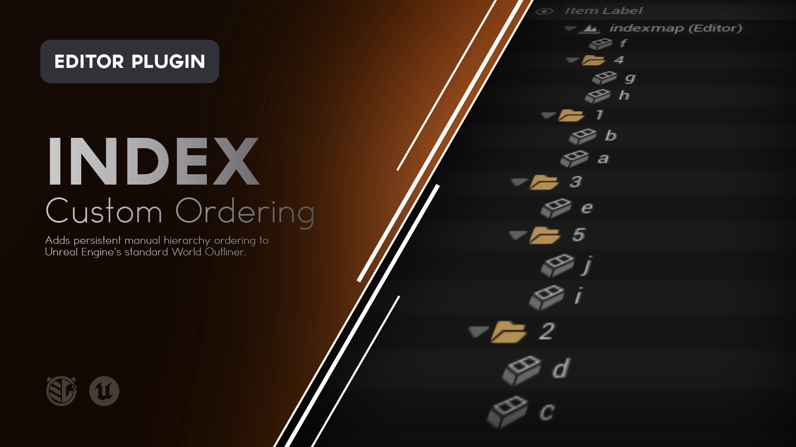
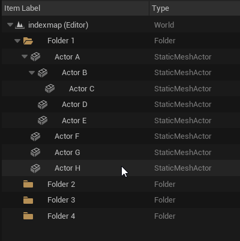
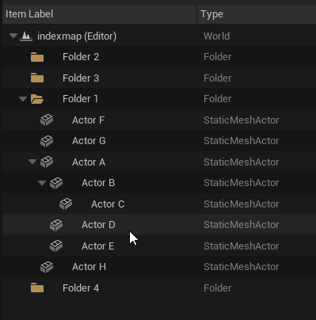

# Index

### Put your World Outliner in the order that makes sense to you.

**Persistent manual Actor and Folder ordering for Unreal Engine's World Outliner.**

Unreal's World Outliner is great at showing what's in a level. But the order you *want* to work in isn't always alphabetical. You shouldn't need names like `01_Gameplay`, `02_Environment` and `03_Lighting` just to keep related content where you want it.

**Index gives you direct control over that order.** Drag Actors and Folders into place, keep their real names, and save the arrangement with your level. It works inside the familiar World Outliner—no separate organizer window or replacement hierarchy.



> ### 📖 [**Explore the Index Documentation Website**](https://mippi-the-dork.github.io/Index/)
>
> Everything you need to install and use Index, from your first reorder to multi-selection, hierarchy operations, saving, Project Settings, and technical implementation.
>
> **[Getting Started](https://mippi-the-dork.github.io/Index/?page=01-getting-started/README.md)** · **[Ordering and Dragging](https://mippi-the-dork.github.io/Index/?page=02-ordering-and-dragging/README.md)** · **[Full Feature Reference](https://mippi-the-dork.github.io/Index/?page=03-hierarchy-and-lifecycle/README.md)** · **[Technical Documentation](https://mippi-the-dork.github.io/Index/?page=05-architecture-and-support/README.md)**

---

## Your level. Your order.

Imagine an Outliner full of gameplay Actors, lights, environmental Folders, and volumes. Alphabetical ordering scatters related work throughout the hierarchy. Number prefixes may help today, but they become another naming convention to maintain.

Index separates **what something is named** from **where it belongs**.

For example, you might want:

```text
BP_PlayerStart
Gameplay/
Environment/
DirectionalLight
PostProcessVolume
Audio/
BP_Checkpoint
```

You choose the sequence, and each Folder or attached Actor hierarchy can have its own order. Rename an Actor later without losing its position.

**The result:** a World Outliner organized for how your team builds levels, not for how strings sort.

## Reordering feels like part of Unreal



Drag a compatible Actor or Folder toward the **top or bottom edge** of another row. A full-width insertion line shows where the item will land. Release to place it **before or after** the target.

The **center** of the row still supports Unreal's normal hierarchy behavior, such as parenting Actors or moving items into Folders. Index helps you distinguish ordering from structural changes instead of replacing native workflows.

Want a larger target? Hold **Alt** by default while dragging:



The whole row becomes two simple zones: **upper half = Before**, **lower half = After**. The modifier, edge-zone size, and insertion-line colors are configurable.

**[See exactly how drag placement works](https://mippi-the-dork.github.io/Index/?page=02-ordering-and-dragging/edge-zones/DESIGN.md)** · **[Force Reorder guide](https://mippi-the-dork.github.io/Index/?page=02-ordering-and-dragging/force-reorder/DESIGN.md)**

## Built for real level hierarchies

Index isn't limited to moving one Actor at a time.

- **Actors and Folders together.** Interleave them in the same ordered sibling tier wherever Unreal allows it.
- **Multi-selection as a block.** Move several rows together while preserving their existing visual order.
- **Hierarchy-aware movement.** Parent Actors and Folders carry their descendants without flattening the hierarchy.
- **Native parenting and detaching.** Keep ordinary drag-to-parent behavior, plus convenient release-from-parent gestures.
- **Predictable new content.** New items are integrated at the top of their local tier; duplicates normally appear immediately after their source when the relationship is clear.
- **Rename and filter safely.** Changing a label or filtering the Outliner doesn't erase the underlying manual sequence.
- **Undo and Redo.** Supported ordering and hierarchy changes participate in Unreal's editor transaction workflow.
- **Persistent order.** Save the level and retain your organization after switching levels or restarting the editor.

These behaviors are designed around existing Unreal Actor and Folder relationships—not a parallel organization system you have to maintain.

**[Multi-Selection](https://mippi-the-dork.github.io/Index/?page=02-ordering-and-dragging/multi-selection/DESIGN.md)** · **[Parenting and Folders](https://mippi-the-dork.github.io/Index/?page=03-hierarchy-and-lifecycle/parenting/DESIGN.md)** · **[Duplication](https://mippi-the-dork.github.io/Index/?page=03-hierarchy-and-lifecycle/duplication/DESIGN.md)**

## Save the organization, not another asset

Index stores the manual hierarchy sequence in the **level package's metadata**. It doesn't create extra Content Browser assets or sidecar files.

Your saved order is independent of Actor/Folder display names. Index also respects Unreal's existing attachment and Folder structure.

**For teams using Perforce or One File Per Actor:** an Index reorder can mark the **level package** dirty because that's where the order is saved. Make sure that package is saved and included in source control when sharing the arrangement.

**[How saving works](https://mippi-the-dork.github.io/Index/?page=04-saving-and-settings/persistence/DESIGN.md)** · **[Undo and Redo](https://mippi-the-dork.github.io/Index/?page=04-saving-and-settings/undo/DESIGN.md)** · **[Technical persistence details](https://mippi-the-dork.github.io/Index/?page=04-saving-and-settings/persistence/TECHNICAL.md)**

## Documentation: from first drag to engine internals

The [**Index Documentation Website**](https://mippi-the-dork.github.io/Index/) is the primary resource for usage instructions, settings, troubleshooting, examples, and implementation details. Every major topic has a **Design** guide for users and a **Technical** guide for developers.

| Looking for… | Go here |
| --- | --- |
| Install Index and make your first reorder | [Getting Started](https://mippi-the-dork.github.io/Index/?page=01-getting-started/README.md) |
| Before/After zones, Force Reorder, and insertion feedback | [Ordering and Dragging](https://mippi-the-dork.github.io/Index/?page=02-ordering-and-dragging/README.md) |
| Moving hierarchies, duplication, new items, and deletion | [Hierarchy and Lifecycle](https://mippi-the-dork.github.io/Index/?page=03-hierarchy-and-lifecycle/README.md) |
| Project Settings, persistence, Undo/Redo, and World Partition | [Saving and Settings](https://mippi-the-dork.github.io/Index/?page=04-saving-and-settings/README.md) |
| Internal architecture, stable IDs, and source behavior | [Architecture and Support](https://mippi-the-dork.github.io/Index/?page=05-architecture-and-support/README.md) |
| Common problems and fixes | [Troubleshooting](https://mippi-the-dork.github.io/Index/?page=05-architecture-and-support/troubleshooting/DESIGN.md) |
| Current features and possible future direction | [Roadmap](https://mippi-the-dork.github.io/Index/?page=ROADMAP.md) |

> **New to Index?** Start with [**Your First Reorder**](https://mippi-the-dork.github.io/Index/?page=01-getting-started/quickstart/DESIGN.md). It explains the drag gestures, how to recognize a valid insertion, and how to save the result.

## Availability and compatibility

**Current plugin version:** **1.0.0** · **Unreal Engine 5.8** · **Windows 64-bit** · **Editor-only**

The plugin descriptor targets **UE 5.8.0**; the project's existing release documentation lists **5.8.2** as its release target. Use a precompiled package built for your exact Unreal Engine version, or compile the source against your installed engine. Compatibility with other engine versions and platforms is not implied.

- **[GitHub Releases](https://github.com/mippi-the-dork/Index/releases)** — precompiled packages when published.
- **[GitHub Source](https://github.com/mippi-the-dork/Index)** — complete plugin source.
- **[Installation Guide](https://mippi-the-dork.github.io/Index/?page=01-getting-started/installation/DESIGN.md)** — installation methods, building from source, and updating.

Index adds no runtime Actors, Components, or gameplay systems. Its functionality stays in the Unreal Editor.

## What Index doesn't do

Index is intentionally focused on **manual organization of the standard Editor World Outliner**. It doesn't:

- Automatically decide how to organize or alphabetize your hierarchy.
- Rename Actors or Folders, change Actor transforms, or affect gameplay.
- Replace Unreal's attachment system or native Folder relationships.
- Reorder Blueprint Component trees, specialized custom Outliners, or runtime/PIE hierarchies.
- Reorder **unloaded** World Partition Actors before they're loaded into editable Outliner rows.
- Perform custom reordering **across different levels**.
- Add Content Browser assets, runtime hierarchy systems, or packaged-game behavior.

Some complex native hierarchy operations—particularly duplication—can require multiple Undo/Redo steps because Unreal's action and Index's final placement may be separate transactions.

**[Supported behavior and limitations](https://mippi-the-dork.github.io/Index/?page=05-architecture-and-support/limitations/DESIGN.md)**

## Issues, requests, and contributions

**Reporting an issue:** [Open an issue on GitHub](https://github.com/mippi-the-dork/Index/issues). Include your Index and Unreal versions, Windows version, installation method, World Partition/source-control context, steps to reproduce, and the **hierarchy before and after** the operation. Screenshots or a short recording are especially useful for drag/drop problems.

**Feature requests:** [Suggest an improvement through GitHub Issues](https://github.com/mippi-the-dork/Index/issues). Describe the workflow problem and what result would help—not just a particular implementation. That makes it easier to evaluate whether the feature belongs in Index.

**Contributing:** Pull requests are welcome. For significant changes, please open an Issue first to discuss the intended behavior and avoid conflicting work. Contributions should preserve Index's focus on native World Outliner hierarchy ordering.

## License

Index is distributed under the **MIT License**. See [LICENSE](LICENSE) for the full license terms.

---

### Stop naming things just to sort them.

Let Actor and Folder names describe **what they are**. Let Index control **where they appear**.

**[Read the Documentation](https://mippi-the-dork.github.io/Index/)** · **[Get Index](https://github.com/mippi-the-dork/Index/releases)** · **[Report an Issue](https://github.com/mippi-the-dork/Index/issues)**

*Created by Mippi the Dork.*
