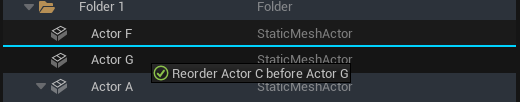

# Index

**Persistent World Outliner Ordering for Unreal Engine**

**Your hierarchy should be organized by how you work—not by what your Actors are named.**

Index gives you **manual, persistent control over Actor and Folder order** inside Unreal Engine's familiar World Outliner. Arrange your level without number prefixes, alphabetical compromises or a separate organizational tool. Drag items into place, preserve their real hierarchy, and save the order with the Level.

    

  

---

## The World Outliner should follow your workflow

A level's most important Actors aren't necessarily first alphabetically. You might want gameplay systems above environmental content, lighting beside the spaces it affects, or frequently edited objects near the top. Without manual ordering, teams often resort to naming tricks like `01_Gameplay` and `02_Environment`.

**Index lets names describe what things are, while you decide where they belong.**

- **Organize without renaming.** Put Actors and Folders in the sequence that makes sense, regardless of their labels.
- **Stay inside the native Outliner.** Reorder with familiar drag/drop gestures and clear Before/After insertion lines.
- **Move meaningful groups.** Reorder multiple selected items as one block, preserving their relative order and attached descendants.
- **Keep Unreal's hierarchy intact.** Ordinary Actor parenting and Folder movement remain available.
- **Save the result.** Manual order is stored with the Level and survives saving and reopening the project.

  

## Explore the documentation

> ### [**Index Documentation — Full User Guide and Technical Reference**](https://mippi-the-dork.github.io/Index/)
>
> **Everything you need to get Index working and make the most of it.** Learn the insertion gestures, organize complex hierarchies, understand saving and Undo, configure preferences, or inspect the underlying Unreal Editor implementation.
>
> **[Get Started](https://mippi-the-dork.github.io/Index/?page=01-getting-started%2FREADME.md)** · **[Ordering and Dragging](https://mippi-the-dork.github.io/Index/?page=02-ordering-and-dragging%2FREADME.md)** · **[Saving & Settings](https://mippi-the-dork.github.io/Index/?page=04-saving-and-settings%2FREADME.md)** · **[Troubleshooting](https://mippi-the-dork.github.io/Index/?page=05-architecture-and-support%2Ftroubleshooting%2FDESIGN.md)**

The README is an overview of what Index offers. **The [documentation website](https://mippi-the-dork.github.io/Index/) is the maintained reference for exact interaction behavior, installation, examples and technical details.**

## Manual ordering, without changing your hierarchy

Index adds an ordering layer to the standard World Outliner. Each compatible sibling tier can have its own arrangement—including a mixture of Actors and Folders—without changing what is attached to what.

| Capability | What you can do |
| --- | --- |
| **[Before / After Insertion](https://mippi-the-dork.github.io/Index/?page=02-ordering-and-dragging%2Fedge-zones%2FDESIGN.md)** | Drag to a row's upper or lower edge to insert precisely before or after another item. |
| **[Force Reorder](https://mippi-the-dork.github.io/Index/?page=02-ordering-and-dragging%2Fforce-reorder%2FDESIGN.md)** | Hold Alt by default to expand the insertion zones to the full upper and lower halves of a row. |
| **[Mixed Actors and Folders](https://mippi-the-dork.github.io/Index/?page=02-ordering-and-dragging%2Fmixed-siblings%2FDESIGN.md)** | Interleave Actor and Folder rows wherever Unreal permits, with a separate order for each child tier. |
| **[Multi-Selection](https://mippi-the-dork.github.io/Index/?page=02-ordering-and-dragging%2Fmulti-selection%2FDESIGN.md)** | Move several selected items together while retaining their relative visual order. |
| **[Hierarchy-Aware Dragging](https://mippi-the-dork.github.io/Index/?page=03-hierarchy-and-lifecycle%2Fparenting%2FDESIGN.md)** | Keep native parenting and Folder movement; release a child from its parent with the supported gesture. |
| **[New Items and Duplication](https://mippi-the-dork.github.io/Index/?page=03-hierarchy-and-lifecycle%2Fduplication%2FDESIGN.md)** | Place new content at the top of its local tier and duplicates beside their sources when the relationship is clear. |
| **[Saved Ordering and Undo](https://mippi-the-dork.github.io/Index/?page=04-saving-and-settings%2Fpersistence%2FDESIGN.md)** | Retain a Level's manual order across editor sessions and use Unreal's native Undo/Redo workflow. |
| **[Configurable Feedback](https://mippi-the-dork.github.io/Index/?page=04-saving-and-settings%2Fpreferences%2FDESIGN.md)** | Customize insertion-line colors, edge thresholds and the Force Reorder modifier. |

Index changes **the order you see in the Outliner**, not Actor transforms or gameplay behavior.

## Useful in real production workflows

### Organize a level without naming tricks

Keep `BP_PlayerStart`, `Gameplay`, `Environment` and your key volumes in the order your team expects to find them. Renaming or filtering the Outliner doesn't intentionally replace that saved sequence.

  

### Reorder quickly without accidental parenting

Drop near the top or bottom edge for a Before/After insertion. The center of the row keeps Unreal's normal hierarchy action. When you need a larger target, hold **Alt** (by default) for upper-half and lower-half insertion zones.

  

### Move related content together

Select several Actors and Folders, then move them as one ordered block. If a selected parent has descendants, Index keeps that subtree intact rather than flattening it into the destination tier.

[**Learn about multi-selection and hierarchy operations →**](https://mippi-the-dork.github.io/Index/?page=02-ordering-and-dragging%2Fmulti-selection%2FDESIGN.md)

### Keep your organization after restarting

Index saves the manual sequence in the **Level package's metadata**, without sidecar files or additional Content Browser assets. Undo/Redo integrates with Unreal's Editor transactions.

For **One File Per Actor and Perforce**, remember that a reorder may dirty the **Level package** even when the Actors themselves are stored in external packages. Check out and save the appropriate Level when sharing its order.

[**Learn how Level saving, source control and Undo work →**](https://mippi-the-dork.github.io/Index/?page=04-saving-and-settings%2Fpersistence%2FDESIGN.md)

## Get Index

**Index v1.0.0** targets **Unreal Engine 5.8.x on Windows 64-bit** and runs in the **Editor only**.

The plugin descriptor specifies UE **5.8.0**, while the existing release documentation identifies **5.8.2** as its target. Use a release built for your exact engine version, or compile the source against your installation. Additional platforms or engine versions should not be assumed compatible.

For most users, choose a compatible prebuilt release or install through Fab if available. Developers can also build from the complete source in this repository.

**[Download GitHub Releases](https://github.com/mippi-the-dork/Index/releases)** · **[Installation Guide](https://mippi-the-dork.github.io/Index/?page=01-getting-started%2Finstallation%2FDESIGN.md)** · **[Your First Reorder](https://mippi-the-dork.github.io/Index/?page=01-getting-started%2Fquickstart%2FDESIGN.md)**

## Important limitations

Index is an **Editor hierarchy organization tool**, not a runtime system, cross-Level organizer or replacement for Unreal's native Actor/Folder hierarchy.

- **Loaded Actors and Folders only.** Unloaded World Partition Actors must be loaded before they can be targeted by manual Outliner dragging.
- **Compatible sibling tiers only.** Index doesn't provide custom manual reordering across different Levels or bypass Unreal's valid parent relationships.
- **Standard World Outliner only.** Blueprint Component trees, specialized Outliners and PIE/runtime hierarchy lists are outside its editing scope.
- **Manual organization, not automatic sorting.** Index doesn't rename or automatically classify content, modify Actor transforms, or alter gameplay.
- **Level-owned ordering.** Index changes can dirty the Level package. Saving only External Actor packages may not preserve its sequence; validate source-control workflows in your own project.
- **Native Undo boundaries apply.** Complex hierarchy operations, particularly duplication, can take more than one Undo/Redo step.

For full details, see [Supported Behavior and Limitations](https://mippi-the-dork.github.io/Index/?page=05-architecture-and-support%2Flimitations%2FDESIGN.md) and [Troubleshooting](https://mippi-the-dork.github.io/Index/?page=05-architecture-and-support%2Ftroubleshooting%2FDESIGN.md).

## What's next?

Index v1.0.0 establishes **persistent manual Actor and Folder ordering**, with native drag/drop behavior, hierarchy-aware movement and Level-based saving.

Future improvements haven't been assigned a release version or committed scope yet. The roadmap records the current foundation and questions worth evaluating, without presenting them as announced features.

[**View the Index Roadmap →**](https://mippi-the-dork.github.io/Index/?page=ROADMAP.md)

## Issues, feature requests and contributions

Found a bug? Please [open an issue](https://github.com/mippi-the-dork/Index/issues) with your Index/Unreal versions, installation method, affected hierarchy before and after, steps to reproduce and screenshots, video or Output Log excerpts where helpful. Include World Partition and source-control context if relevant.

Have an idea? [Submit a feature request](https://github.com/mippi-the-dork/Index/issues) describing the workflow problem and outcome you'd like, so the feature can be evaluated within Index's scope.

**Pull requests are welcome.** For major changes, open an issue first to discuss the intended behavior. Index aims to remain focused, predictable and native to the World Outliner.

## License

Index is distributed under the **MIT License**. See [LICENSE](LICENSE) for the full terms.

---

**Index is created by Mippi the Dork.**

**[Explore the Documentation](https://mippi-the-dork.github.io/Index/)** · **[Get Index](https://github.com/mippi-the-dork/Index/releases)** · **[Report an Issue](https://github.com/mippi-the-dork/Index/issues)**
