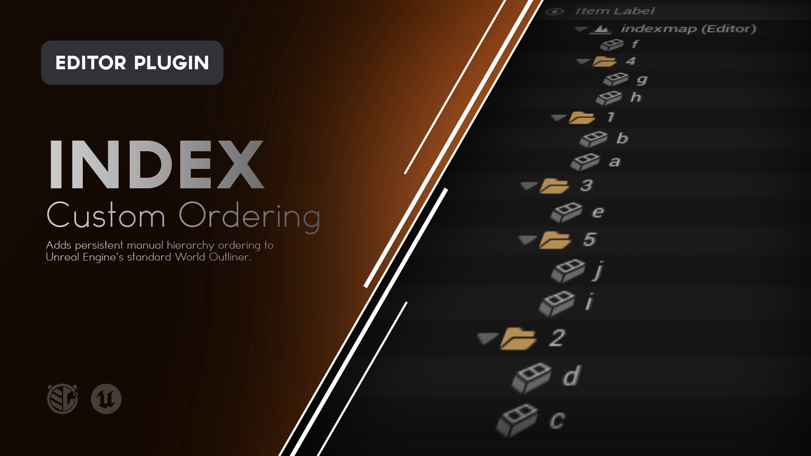

# What Index Does — Design

**Index v1.0.0 · User guide**

## Organize by meaning, not by naming convention

Index lets you determine the **manual order of Actors and Folders in Unreal Engine's World Outliner**. You can put a Folder between two Actors or move a gameplay group above environmental items without adding number prefixes or changing labels.

Index keeps Unreal's actual Folder and Actor attachment hierarchy. It adds an ordering layer within each compatible set of siblings, rather than moving objects in the world.

*Index allows Actors and Folders to occupy an intentionally ordered World Outliner hierarchy.*

## When Index helps

- **Scene organization:** Put frequently edited gameplay Actors at the top and supporting environment items below.
- **Mixed hierarchies:** Interleave Actors and Folders at the same permitted hierarchy tier.
- **Production consistency:** Keep a manual hierarchy order when names change or when an Outliner is filtered.
- **Batch movement:** Move several selected Actors/Folders as a block while retaining their relative order.

## What changes—and what doesn't

Moving an Actor **before or after** a sibling changes its place in the Outliner. Dragging **onto the center** of another row performs the relevant native hierarchy operation when permitted, such as moving into a Folder or attaching to an Actor. Index does not reposition Actors in 3D space, affect gameplay, change component order or introduce runtime code.

<figure class="doc-media" data-media-id="overview-ordering" data-kind="image">

<figcaption>Manual Outliner ordering keeps labels meaningful while allowing a custom visual sequence.<strong>Capture instructions · Image:</strong> Capture the standard Unreal World Outliner with an intentionally nonalphabetical order mixing at least two Actors and two Folders in one tier. Include the Index drag insertion line or custom ordering result, but do not show a separate Index application.</figcaption>
</figure>

## Where the controls live

You work directly in the **standard World Outliner**, not in a separate Index window. Drag a row to a target edge; a colored full-width line previews the insertion. Use **Project Settings → Plugins → Index** to adjust the colors, edge size and Force Reorder modifier. See [First Reorder](../quickstart/DESIGN.md).

---

For engine integration and implementation, [read Technical](TECHNICAL.md).
