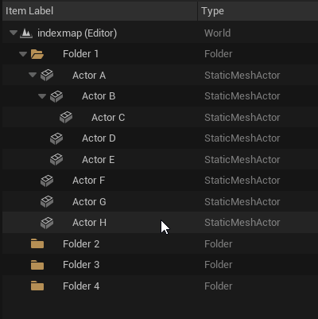

# Your First Reorder — Design

**Index v1.0.0 · User guide**

## Reorder a few Actors

Open a disposable level with at least three Actors or Folders in the World Outliner.

1. Start dragging the row you want to move.
2. Hover the **top 10%** of the destination row (default setting). A full-width insertion line marks **Before**.
3. Release. The dragged row moves immediately above the destination.
4. Repeat at the **bottom 10%** to insert **After**.
5. Save the level to persist the manual order.

The center of the row is reserved for hierarchy operations such as parenting or moving an item into a Folder. If there is no Index insertion line, read the native hierarchy tooltip before releasing.

*Before/After insertion lines identify exactly where the dragged row will be placed.*

## Try Force Reorder

Hold **Alt** while dragging (default). The target's upper half becomes Before, and its lower half becomes After; this gives you much larger reorder zones. You can change the modifier in Project Settings.

<figure class="doc-media" data-media-id="quickstart-force" data-kind="gif">

<figcaption>Force Reorder expands the drop areas, making precise placement easier in dense Outliners.<strong>Capture instructions · GIF:</strong> Record dragging an Actor onto a target row, first showing the small normal top and bottom edge zones, then holding Alt so the entire upper and lower halves become reorder zones. Show the insertion line and final moved row.</figcaption>
</figure>

## Confirm persistence

Save the affected level with **File → Save** or **Save All**, close/reopen it, and verify the sequence. Index stores a hierarchy snapshot in level package metadata rather than creating a sidecar file.

## Fix common first-use mistakes

If the row gets parented instead of reordered, hover closer to the edge or hold Alt. If nothing happens, verify **Enable Custom Ordering** under Project Settings and that the source and target belong to compatible level/hierarchy contexts.

See [Edge Drop Zones](../../02-ordering-and-dragging/edge-zones/DESIGN.md) for all placement details.

---

For engine integration and implementation, [read Technical](TECHNICAL.md).
