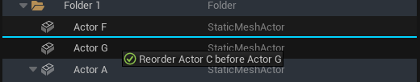
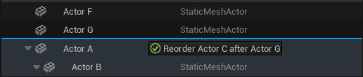

# Before and After Drop Zones — Design

**Index v1.0.0 · User guide**

## Three regions of a target row

| Pointer region | Expected action |
| --- | --- |
| **Top edge** | Insert the dragged Actor/Folder **before** the target |
| **Center** | Use the hierarchy action shown in Unreal's drag tooltip |
| **Bottom edge** | Insert the selection **after** the target |

The default edge threshold is **10% of row height** at both top and bottom, configurable from 1% to 45%. A reorder preview displays a full-width insertion line; the center retains parenting, moving into Folders or other valid native hierarchy actions.

*The upper insertion line indicates that the dragged item will appear before the target.*

*The lower insertion line indicates that the dragged item will appear after the target.*

## Example: move Gameplay above Environment

Drag the **Gameplay** row onto the upper edge of **Environment** and wait for the line before releasing. Both rows remain at their existing sibling level. If you see a parent/move tooltip instead, reposition the cursor or hold the Force Reorder modifier.

<figure class="doc-media" data-media-id="edge-zone-comparison" data-kind="image">

<figcaption>The small top and bottom reorder regions leave the middle of a row available for normal hierarchy operations.<strong>Capture instructions · Image:</strong> Capture an enlarged Outliner destination row with clearly marked top 10%, center 80%, and bottom 10% zones. Use actual Index insertion-line colors and label Before, Native Hierarchy, and After.</figcaption>
</figure>

## Edge between an expanded parent and first child

An apparent gap immediately beneath an expanded parent can be the same insertion position as the top edge of its first visible child. Index resolves this boundary against the child's sibling tier, preventing a drag from accidentally targeting the outer level. Check the preview line's indentation and the tooltip.

---

[Technical implementation](TECHNICAL.md) · [Ordering and Dragging overview](../README.md)
