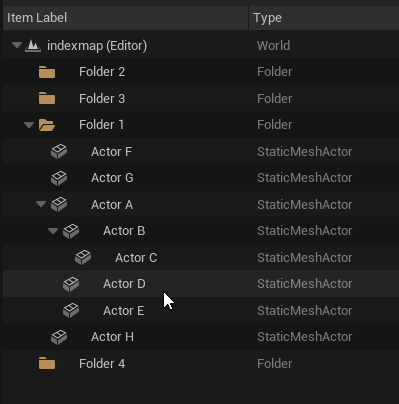

# Force Reorder Modifier — Design

**Index v1.0.0 · User guide**

## Make the entire row a reorder target

Holding the configured modifier during a drag splits the target row into two halves: **upper half = Before**, **lower half = After**. This eliminates the need to aim at a narrow edge when you only want a sequence change.

**Alt** is the default. Under **Project Settings → Plugins → Index**, choose Alt, Shift, Ctrl, or None / Disabled.

*Force Reorder enlarges the valid insertion areas while you hold its modifier.*

## Use it safely

Drag the source row, hold **Alt**, hover the destination's upper or lower half, and confirm the insertion line. Release to apply the move. Don't assume a center drop will parent the item while the modifier is held: the two halves now both request ordering.

<figure class="doc-media" data-media-id="force-modifier-gestures" data-kind="gif">

<figcaption>The same target row switches between small edge zones and two full half-row zones while Force Reorder is held.<strong>Capture instructions · GIF:</strong> Record the cursor hovering the center of an Actor row during a drag, then hold Alt to show Before and After regions as you move between the upper and lower halves. Release Alt to show that the normal center hierarchy behavior returns.</figcaption>
</figure>

## When to change the modifier

Choose a modifier that does not conflict with how your team commonly navigates the editor. Setting it to **None / Disabled** turns off this expanded mode; narrow top/bottom edge insertion still works.

## Troubleshooting

If Alt does not expand the zones, confirm the preference and that the key was held while dragging a valid Actor/Folder payload over the standard World Outliner.

---

[Technical implementation](TECHNICAL.md) · [Ordering and Dragging overview](../README.md)
