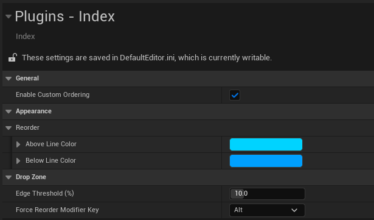

# Project Settings and Visual Feedback — Design

**Index v1.0.0 · User guide**

## Where to find preferences

Open **Project Settings → Plugins → Index**.

*Project Settings control Index's insertion indicators, drop regions and Force Reorder modifier.*

| Setting | Default | Purpose |
| --- | --- | --- |
| Enable Custom Ordering | Enabled | Controls whether Index custom ordering is active |
| Above Line Color | Light blue | Before insertion feedback |
| Below Line Color | Deeper blue | After insertion feedback |
| Edge Threshold (%) | 10% | Top/bottom target zones; range 1–45% |
| Force Reorder Modifier Key | Alt | Expands target into upper/lower halves; Alt, Shift, Ctrl or None |

## Make insertion easier

If you keep dropping into a Folder when you intended to reorder, increase the edge threshold moderately or hold the modifier during a drag. A larger edge area reduces the center area reserved for native hierarchy operations.

<figure class="doc-media" data-kind="image" data-media-id="settings-edge-zones"><figcaption>Drop-zone size and insertion colors can be adjusted without changing saved hierarchy data.<strong>Capture instructions · Image:</strong> Show the Index Project Settings panel with Edge Threshold set to 10%, Above and Below colors, and Force Reorder Modifier. Beside it, capture a normal Outliner row with a visible insertion line and readable target name.</figcaption></figure>

## Disable and restore

Turning off Enable Custom Ordering stops Index's custom drag reorder behavior; it does **not** delete the previously saved Level metadata. Re-enable ordering when you want to use Index again.

---

[Read Technical](TECHNICAL.md)
