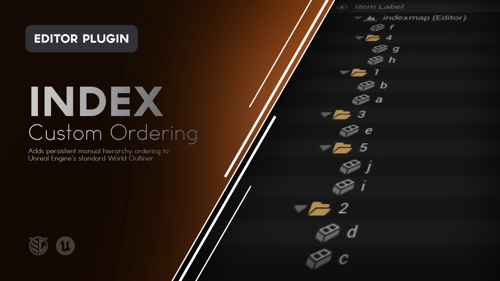
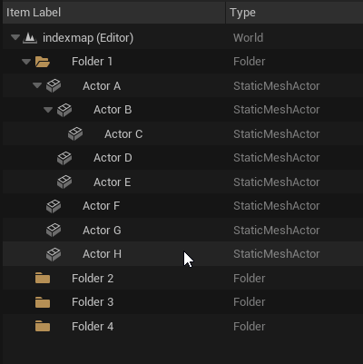

# Index Documentation

**Index v1.0.0 · Unreal Engine 5.8 · Win64 · Editor-only**

Index gives you **persistent manual control over Actor and Folder order in Unreal Engine's World Outliner**. Arrange rows by how your team thinks about the level—not by alphabetical labels or artificial number prefixes—without replacing Unreal's native hierarchy.

*Index adds precise, persistent ordering to the familiar World Outliner.*

## What can I do with Index?

**Manually arrange a level.** Drag an Actor or Folder to the top or bottom edge of another row; Index draws a full-width line showing exactly where the selection will be inserted.

**Keep native hierarchy behavior.** The center of a target row still supports compatible Actor parenting and Folder movement. Index recognizes when dropping a child onto its existing parent should release that relationship.

**Move several rows at once.** Multi-selections retain their original visual order, and parent Actors/Folders carry their descendants without flattening them.

**Keep the result.** Saved sequences live in Level package metadata, survive restarts, and don't depend on Actor/Folder names. New items normally start at the top of their tier; clear duplicates appear after their source.

**Control the gesture.** Hold Alt to expand row insertion regions, or customize the modifier, threshold and insertion colors in Project Settings.

## Get started in three steps

1. [Install Index](01-getting-started/installation/DESIGN.md) in a compatible Unreal Editor project.
2. [Make your first manual reorder](01-getting-started/quickstart/DESIGN.md) by dragging a loaded Actor to the top or bottom edge of a compatible row.
3. [Save the Level](04-saving-and-settings/persistence/DESIGN.md) so the hierarchy sequence persists. With Perforce/OFPA, remember the order metadata belongs to the **Level package**.

*A before/after insertion changes the saved sibling sequence without renaming the items.*

## Which guide do I read?

Choose **Design** for the control's purpose, exact mouse interaction, examples, prerequisites and common problems. Choose **Technical** for C++ classes, native Unreal event paths, parent-specific sequence logic, metadata storage and integration limits. Every topic has a paired Design and Technical page.

## Explore the manual

| Category | Topics | What you'll find |
| --- | ---: | --- |
| [01. Getting Started](01-getting-started/README.md) | 3 | Purpose, installation and first reorder |
| [02. Ordering and Dragging](02-ordering-and-dragging/README.md) | 5 | Edge insertion, Force Reorder, tooltips, siblings and multi-selection |
| [03. Hierarchy and Lifecycle](03-hierarchy-and-lifecycle/README.md) | 7 | Parenting, detaching, creation, duplication, filters, root drops and deletion |
| [04. Saving and Settings](04-saving-and-settings/README.md) | 4 | Level metadata, Undo/Redo, preferences and World Partition |
| [05. Architecture and Support](05-architecture-and-support/README.md) | 4 | Source design, identities, limitations and troubleshooting |

## Understand Index's boundaries

Index is an **Editor hierarchy organization tool**, not a runtime system. It doesn't reorder unloaded World Partition Actors, arbitrary custom Outliners or Blueprint Component rows. It doesn't edit Actor transforms or permit arbitrary custom reordering across different Levels. Native parenting/Folders remain Unreal's responsibility.

The saved order is Level-owned. A new manual position may therefore mark the **Level package** dirty even if Actor data uses One File Per Actor.

## Current and future development

[Roadmap](ROADMAP.md) documents the released v1.0.0 capabilities and areas that could be considered later. Future versions are **not scheduled or promised** without an explicit product plan.

## Project and support

- [Index repository](https://github.com/mippi-the-dork/Index)
- [Index Releases](https://github.com/mippi-the-dork/Index/releases)
- [Report an issue](https://github.com/mippi-the-dork/Index/issues)
- [Documentation Media Inventory](MEDIA_INVENTORY.md)

**Documentation basis:** Index v1.0.0 source, README and architecture notes. Detailed editor behavior was reviewed against source; exhaustive live UE/Perforce/browser testing is tracked separately.
